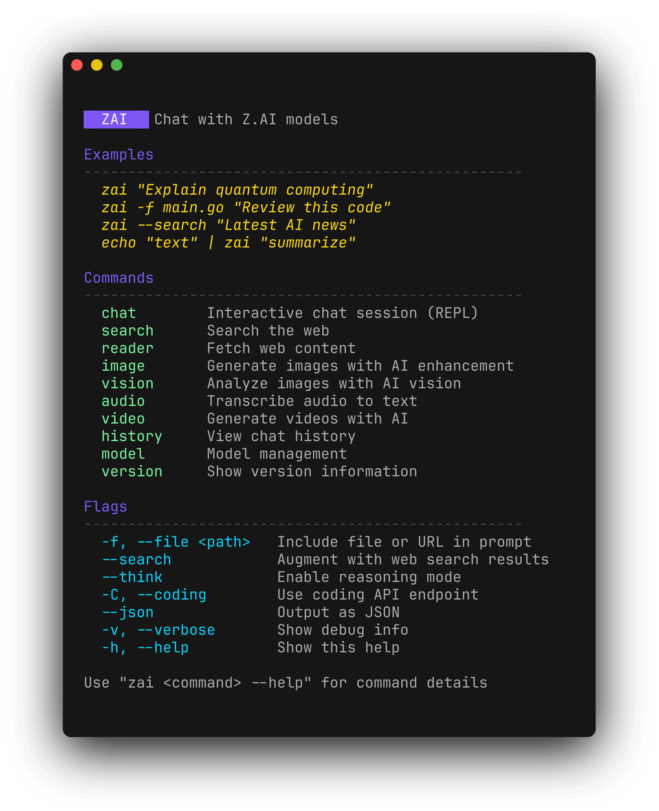

# ZAI

A fast, feature-rich CLI for [Z.AI](https://z.ai) GLM models.



## Features

- **Chat** - Interactive REPL with conversation context
- **Account quota** - Read Coding Plan usage windows without model generation
- **Web Search** - Search the web and get AI-summarized results
- **Web Reader** - Fetch and analyze web content
- **Image Generation** - AI-enhanced prompts with auto-download
- **Vision** - Analyze images and extract text
- **Audio** - Transcribe audio files and YouTube videos
- **TTS** - Text-to-speech synthesis with multiple voices
- **Embeddings** - Generate text embedding vectors
- **Video** - Generate videos from text or images
- **Pipes** - Full stdin/stdout support for scripting

## Installation

```bash
go install github.com/dotcommander/zai@latest
```

Or build from source:

```bash
git clone https://github.com/dotcommander/zai.git
cd zai
go build -o bin/zai .
```

## Configuration

Set your API key:

```bash
export ZAI_API_KEY="your_api_key"
```

Or create `~/.config/zai/config.yaml`:

```yaml
api:
  key: "your-api-key"
  model: "glm-4.7"        # default model
  coding_plan: true       # use Coding API endpoint
```

## Usage

### Account quota

```bash
zai usage
zai usage --json
```

Uses the configured API key and approved HTTPS provider origin only. Quota availability depends on account entitlement and the provider monitoring endpoint; it does not generate a chat response.

### Chat

```bash
# One-shot
zai "What is the meaning of life?"

# With file context
zai -f main.go "Review this code"

# Interactive REPL
zai chat

# With reasoning mode
zai --think "Solve this step by step"

# Web search augmented
zai --search "Latest news on AI"
```

### Pipes

```bash
cat error.log | zai "What's wrong?"
git diff | zai "Write a commit message"
pbpaste | zai "Summarize this"
```

### Web

```bash
# Search
zai search "golang best practices"
zai search "AI news" -c 5 -r oneWeek

# Read web pages
zai reader https://example.com
zai "Summarize https://example.com/article"  # auto-detected
```

### Image Generation

```bash
zai image "a wizard in a library"
zai image "sunset" --size 1024x1024
zai image "logo" -o logo.png --no-enhance
```

Images are automatically enhanced with professional photography prompts and saved locally.

### Vision

```bash
zai vision -f photo.jpg
zai vision -f screenshot.png "What text is here?"
zai vision -f chart.png "Explain the trends"
```

### Audio

```bash
zai audio -f recording.wav
zai audio -f podcast.mp3 --vad              # Remove silence
zai audio --video https://youtu.be/xxx      # YouTube
zai audio -f lecture.wav --hotwords "k8s,docker"
```

Supports: .wav, .mp3, .mp4, .m4a, .flac, .aac, .ogg

**Optional dependencies**: `ffmpeg`, `yt-dlp` (for YouTube)

### Text to Speech

```bash
zai tts "Hello, world!"
zai tts "Welcome" --voice xiaochen
echo "text" | zai tts --output out.wav
```

Voices: tongtong (default), xiaochen, chuichui, jam, kazi, douji, luodo

### Embeddings

```bash
zai embed "Hello, world!"
zai embed "sentence one" "sentence two"
echo "text" | zai embed
```

Always outputs JSON embedding vectors.

### Video

```bash
zai video "A cat playing"
zai video -f https://example.com/image.jpg "Animate this"
zai video -f https://example.com/first.jpg -f https://example.com/last.jpg "transition"
```

Image inputs must be absolute HTTP(S) URLs; local image files are unsupported.

Videos are saved as `zai-video-{timestamp}.mp4`. Generation takes 1-3 minutes.

### JSON Output

```bash
zai "What is 2+2?" --json
zai search "query" --json
zai history --json
```

## Full API requests

Use `--request-json FILE` (or `-` for stdin) on chat, vision, image,
video, audio, search, and reader to preserve all request fields and receive
complete JSON responses with `--json`. Ordinary output extracts text, URLs, or
task identifiers. Explicitly supplied supported flags override matching
JSON fields; ordinary flag defaults do not. Positional prompts also override
matching JSON prompt/message fields.

```bash
zai chat --request-json chat.json --json
cat chat.json | zai chat --request-json - --events
zai image --async --request-json image.json --wait --wait-timeout 3m --poll-interval 2s
zai task get TASK_ID
zai tokenize --request-json tokenizer.json
zai files upload document.pdf --purpose user_data
```

`--events` emits SSE events as NDJSON with `event`, `data`, and an optional
`id`. See [Global API coverage](docs/global-api.md) for all routes, multipart
requests, async workflows, protocol compatibility limits, and the checked-in
operation/field inventory. TTS, embeddings, and model convenience commands
remain available; omission from the current global OpenAPI does not establish
that their endpoints are unavailable.

Discover available MCP tools with `zai mcp search tools`, then invoke one with
`zai mcp search call TOOL --request-json arguments.json`. See [MCP commands](docs/mcp.md)
for all four products and local Vision runtime requirements. Chat tool streaming
is available through `--tool-stream`.

## Commands

| Command | Description |
|---------|-------------|
| `chat` | Interactive chat session |
| `search` | Web search |
| `reader` | Fetch web content |
| `image` | Generate images |
| `video` | Generate videos |
| `vision` | Analyze images |
| `audio` | Transcribe audio |
| `tts` | Text-to-speech synthesis |
| `embed` | Generate text embeddings |
| `history` | View chat history |
| `model` | Model management |
| `task get` | Retrieve an asynchronous image/video task |
| `tokenize` | Token counting |
| `layout` | Document layout parsing |
| `files upload` | Upload a file |
| `agent run/result/conversation` | Agent requests and results |
| `responses` / `messages` | Protocol compatibility JSON requests |
| `api` | Execute a registered operation |
| `mcp vision/search/reader/zread tools/call` | Discover and invoke Coding Plan MCP tools |

## Flags

| Flag | Description |
|------|-------------|
| `-f, --file` | Include file or URL in prompt |
| `--search` | Augment with web search |
| `--think` | Enable reasoning mode |
| `-C, --coding` | Use Coding API endpoint |
| `--json` | Output as JSON |
| `--system` | Custom system prompt |
| `-v, --verbose` | Show debug info |

## Shell Completion

```bash
# Bash
zai completion bash > ~/.local/share/bash-completion/completions/zai

# Zsh
zai completion zsh > "${fpath[1]}/_zai"

# Fish
zai completion fish > ~/.config/fish/completions/zai.fish
```

## Documentation

See [docs/documentation.md](docs/documentation.md) for the full documentation index.

## Requirements

- Go 1.25.4+ (the version declared in `go.mod`)
- Z.AI API key

## License

MIT
